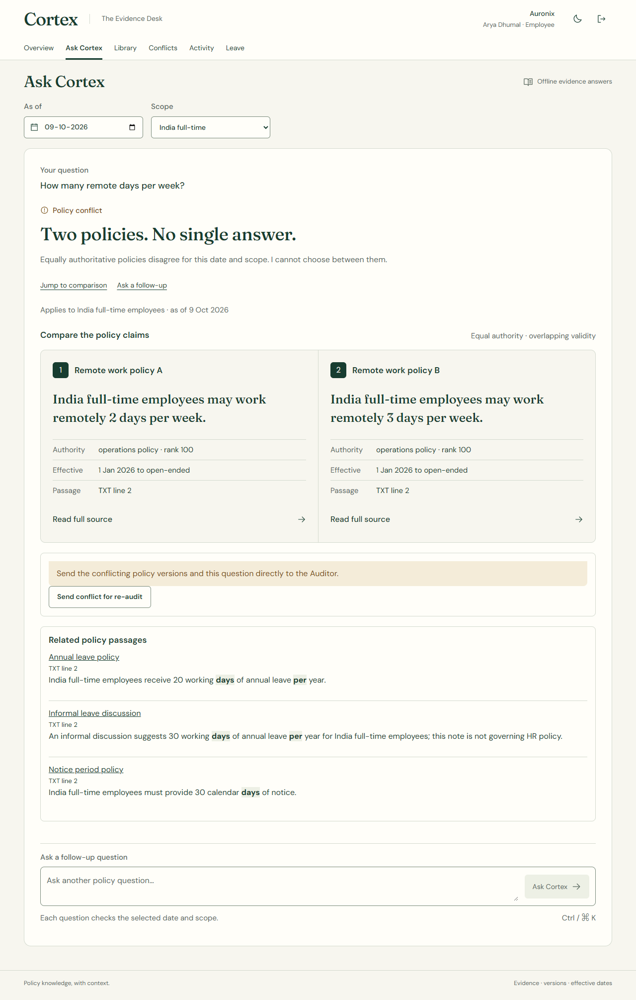
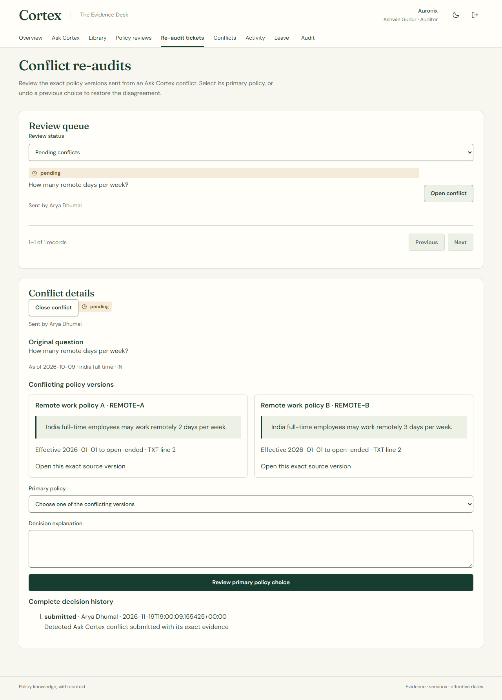
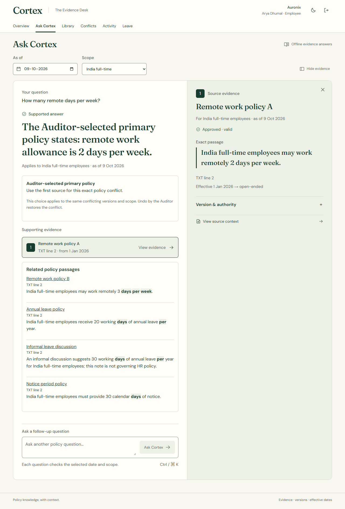
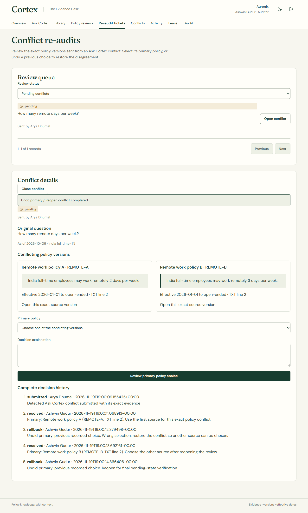

# Conflict re-audit — actual corrected flow

Captured 2026-11-20 from the built app and isolated fictional backend on port 8009. The supplied owner screenshot was the diagnostic before state: an Employee-generated manual ticket with two unavailable policies and an empty Auditor dropdown. The following are actual browser captures of the corrected implementation, not mockups.

| Before | After |
|---|---|
| Employee navigates to a policy-picker/free-text ticket form | Employee clicks one button beside the actual Cortex conflict |
| Auditor lacks READ and sees unavailable sources | Submission records explicit grants; both exact versions and quoted claims are shown |
| Resolution only annotates the ticket | The selected primary becomes the cited answer for the same eligible conflict set |
| Rollback only clears the ticket projection | Undo restores conflict abstention, reopens the review and allows another source to be selected |

Narrow-screen originals: [Employee at 320px](employee-light-320.png), [Auditor dark theme at 390px](auditor-dark-390.png). The accepted shell, palette, typography, source evidence behavior and native confirmations remain. These show the requested workflow correction, not a wide redesign or pixel-matched comparison of different data.

Six Chrome scenarios pass, with 24 PNGs covering both roles at 320/390/768/1280/1440 in both themes and the complete primary/undo/reselect flow. The test explicitly checks that the dropdown has the placeholder plus both actual options, neither source was initially readable by Auditor, the Employee has no ticket route/navigation/form, source links target the exact edition, narrow source evidence can open/return, controls accept focus and the document has no horizontal overflow. Full captures and hashes are under ignored `outputs/conflict-reaudit-browser/` and `outputs/conflict-reaudit-captures.json`.

[Detailed API/security/migration verification](../../implementation/CONFLICT_REAUDIT_TEST_REPORT.md). The source fixtures and roles differ from the owner's original screenshot, so no pixel-difference or production-performance claim is made.
