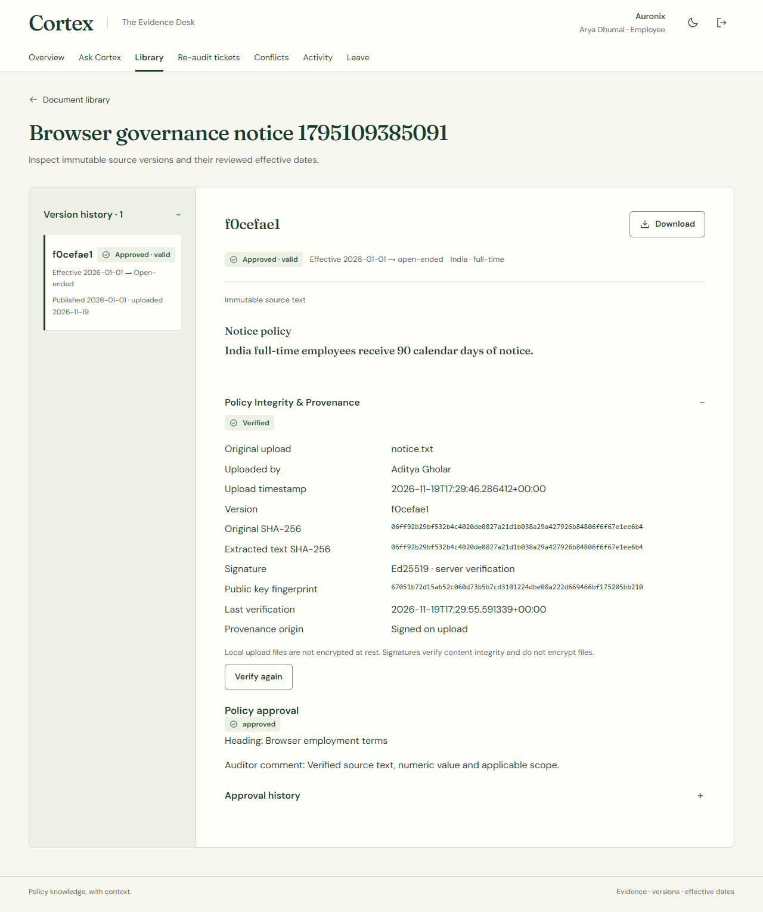

# Governance enhancement — real browser evidence

Captured locally on 2026-11-19 from the production React build and an isolated fictional FastAPI/SQLite database. These are browser screenshots, not concepts or frontend mocks. No public deployment was changed.

The accepted forest/ivory shell, typography, source editions and responsive navigation remain. Before, Admin could review a source and Manager Team controlled leave reads. After, Auditor performs independent reviews, all three roles have appropriate Leave Management tools, and Employee/Auditor have re-audit tickets. Personal balances appear only for Employees.

The [earlier published document screen](../pr8-production-release/document-light-1440.png) is the historical design reference. The current screenshot below shows the new signed provenance and approval history in that same design language. Different fictional records and dates are shown; this is not a pixel-matched performance or layout comparison.

| Screen | Genuine current capture |
|---|---|
| Auditor employee balances/applications at 320px | [Light mobile](auditor-leave-light-320.png) |
| Employee balances/application form at 390px | [Dark mobile](employee-leave-dark-390.png) |
| Admin account creation and people at 320px | [Light mobile](admin-people-light-320.png) |
| Auditor policy tickets at 390px | [Dark mobile](auditor-tickets-dark-390.png) |
| Employee rollback notification and complete history | [Desktop](ticket-rollback-desktop.png) |

The full run produced 103 PNGs: 100 role/screen/theme/width captures and three completed-flow captures. Files under ignored `outputs/governance-browser/`, the capture hash/dimension inventory `outputs/governance-captures.json`, and the HTML report `outputs/governance-browser-report/` are regenerable with `playwright.governance.config.ts`. Six representative original PNGs are retained here.

All new main screens were checked for document horizontal overflow at 320, 390, 768, 1280 and 1440 in both themes. The 320px navigation test verifies keyboard entry, focus containment, Escape and focus restoration. Review confirmations also use the existing native dialog, now with keyboard ownership restricted to the top nested dialog. Explicit select names avoid accessible names being polluted by option text.

See [the complete implementation and test report](../../implementation/GOVERNANCE_TEST_REPORT.md) for API, persistence, permission and cryptographic checks, plus known limits. Screenshot coverage does not establish screen-reader certification or Core Web Vitals.
