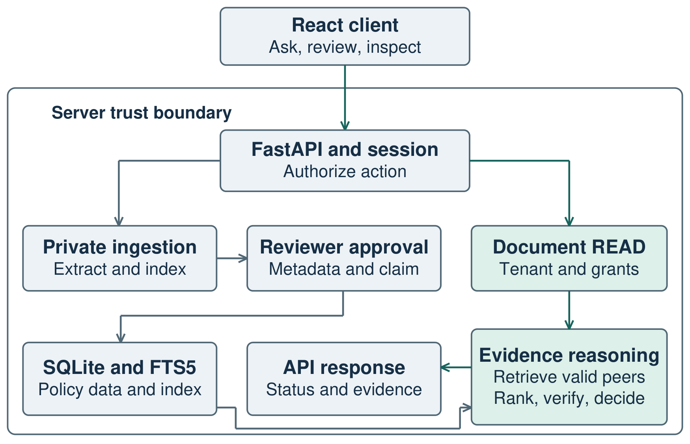
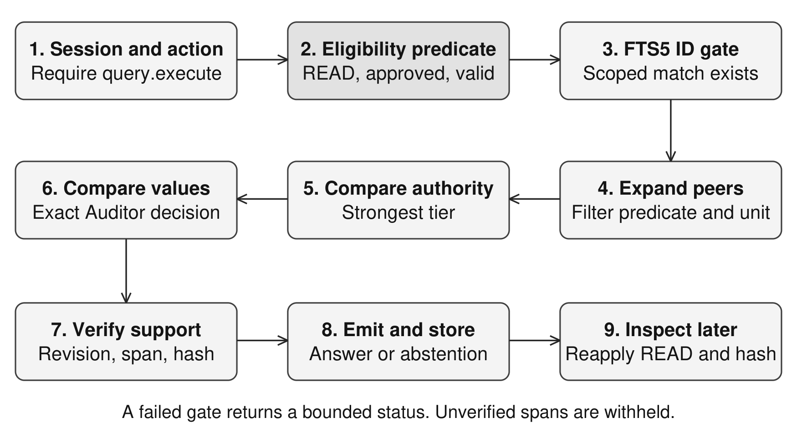
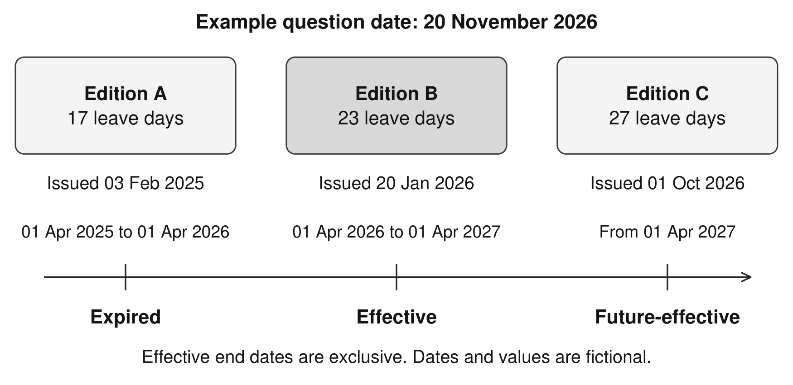
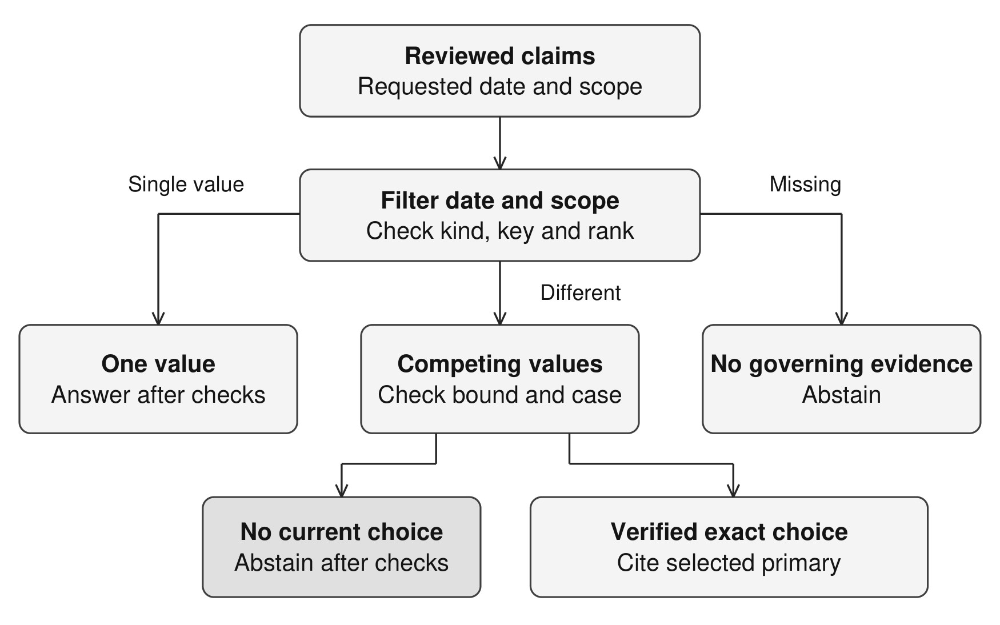
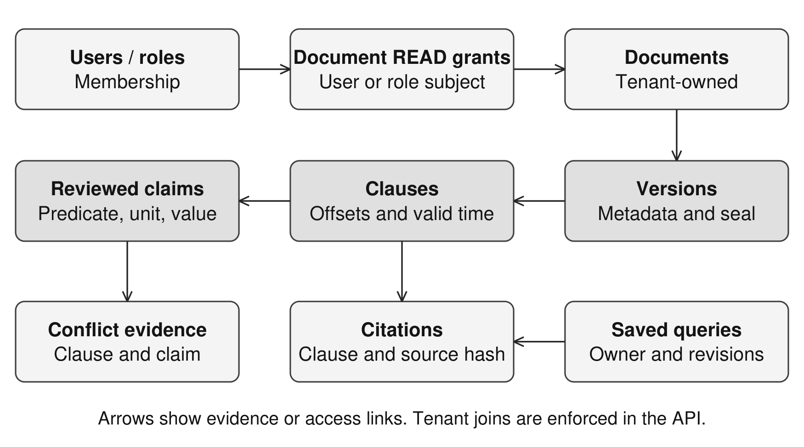
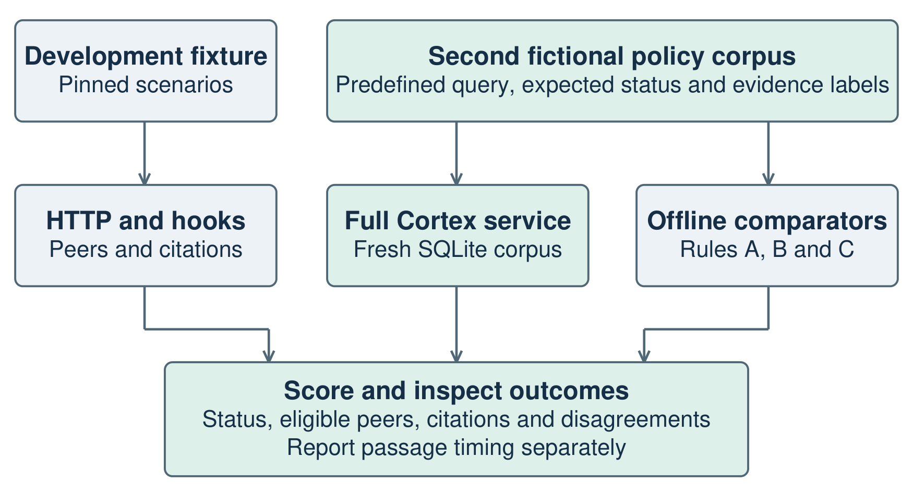
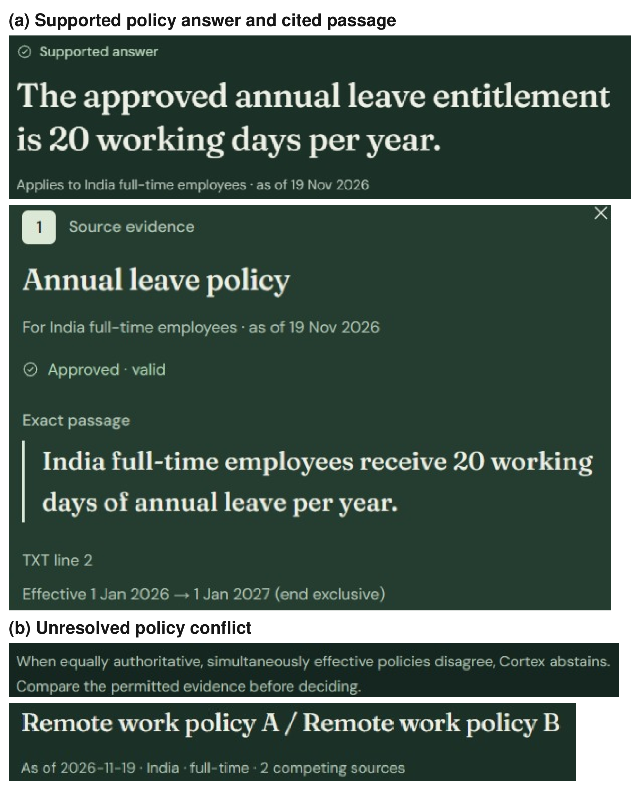

# Introduction

Consider an employee trying to find their annual-leave entitlement. A search may return an older policy, the version currently in force, and a revision that has been approved but is not yet effective. All three can contain the same keywords, yet only one may apply to the requested date. A different problem arises when two applicable policies disagree: citing one of them would conceal the uncertainty. The employee's access rights matter as well, because a policy administrator may see records that the employee is not permitted to read.

Knowledge management research documents organizational barriers to finding and using internal knowledge [@alavi]. Retrieval-augmented generation shows how retrieved documents can ground open-domain answers [@lewis]. Policy answering adds a decision about which sources are admissible and which claims govern. A genuine citation to a future-effective edition or to only one of two competing sources can still support the wrong decision.

Cortex AI addresses this narrower policy-decision problem for four reviewed numeric topics: annual leave, remote work, notice period, and executive bonus. Before producing an answer, it enforces tenant and document access, evaluates approved scope and effective dates, expands the eligible set of comparable claims, and checks authority and disagreement. A supported value is accompanied by an exact source span; an unresolved conflict instead leads to abstention. An Auditor can also record a verifiable resolution for a specific conflict. None of these mechanisms is novel in isolation. What we evaluate is the behavior of their combined, inspectable implementation, from the admissible evidence set to the final answer or abstention.

We reran the development checks and tested the same pipeline on a second fictional corpus. The study defined the applicability and disagreement labels before execution with Codex assistance. The new labels await independent adjudication. A separate experiment examines related-passage retrieval because it does not determine which claim governs.

# Related Work

## Enterprise authorization and lexical retrieval

The NIST role-based access control model formalizes the relationship among users, roles and permissions [@sandhu]. Cortex uses roles for action permissions and document grants for resource visibility. Büttcher and Clarke studied access-aware full-text search over a shared filesystem index and showed that simple postprocessing can expose information about hidden files [@buettcher]. Their work motivates a careful distinction between database index access and the text or ranking statistics available to an application stage. Cortex's shared full-text index stays inside its trusted database. Query eligibility constrains which IDs are returned, and application ranking is computed on admitted records. The experiments observe application boundaries and do not establish the filesystem study's broader security properties.

BM25 formalizes probabilistic lexical ranking [@robertson]. BEIR compares lexical and learned rankings across heterogeneous retrieval tasks [@thakur]. Dense Passage Retrieval shows how learned representations retrieve passages that need not share surface terms with the question [@karpukhin]. Reciprocal rank fusion combines ranked lists without requiring scores on a common scale [@cormack]. These studies motivate testing lexical and semantic passage recall independently. They do not prescribe whether a current policy may override another policy or authorize text retrieval for a given reader.

## Valid time, contradiction and support

Time-aware models condition answers on changing facts [@dhingra]. HoH examines the coexistence of stale and current information in retrieval-augmented answering [@ouyang]. Re3 uses relevance and recency with conflict-aware temporal filtering [@cao]. TimelyRAG reranks passages by clause-level validity in evolving documents [@nam]. Cortex takes an effective interval from reviewed metadata and accepts a requested past, current or future date. Publication recency is a useful comparator because it implements a different notion of precedence.

MultiNLI studies entailment, neutrality and contradiction in sentence pairs [@williams]. Ragability evaluates language models given conflicting and consistent contexts [@gross]. Cortex uses a narrower decision rule: differing normalized integers within the same policy claim key and strongest authority tier. That restriction allows a deterministic test of the rule. It also excludes linguistic exceptions, modality shifts outside the schema and contradictions spread over several clauses. Selective classification supplies the concepts of risk and coverage [@geifman]. Here, answer coverage can be counted directly and abstention is triggered by explicit rules, including missing evidence and unresolved equal-tier disagreement.

ALCE separates citation support from completeness [@gao]. RAGAs separates retrieval and answer quality [@es], and Self-RAG learns when to retrieve and critique [@asai]. For its strict answers, Cortex verifies the stored span, digest and numeric occurrence before rendering a fixed sentence. Human review remains responsible for interpretation. Corpus poisoning research motivates controlling which versions become eligible [@zou]. The effectiveness of review against malicious approved content remains untested.

# Problem Definition and Research Questions

After authentication and routing, we represent a strict policy request as $q=(u,t,s,k)$, where $u$ is the user, $t$ is the as-of date, $s$ is the requested jurisdiction and population, and $k$ is the inferred topic. The notation assumes the supported default condition. Each topic specifies an expected predicate and unit. A reviewed claim records a normalized value, its document version and extracted-text span, applicability metadata, and an authority rank. The service can return a cited value, abstain with a reason, or request clarification. An unresolved conflict can include citations to competing claims.

**RQ1.** How does effective-date filtering change selection relative to publication recency when approval and scope are held fixed? **RQ2.** Does strongest-tier abstention avoid choosing a value in the labeled conflict cases while allowing consistent revisions and concurrent equivalent claims? **RQ3.** Do the fixture's restricted markers reach the observed reasoning, answerer or response stages, and do the tested direct reads succeed? **RQ4.** Do returned citation offsets and digests match the extracted text for the identified source version? **RQ5.** Which designated passages appear with the optional local encoder, and how do warm request times differ?

# System Architecture and Trust Model

Figure 1 shows the principal data flows. The browser sends requests to a FastAPI service. The service derives the user's identity from an opaque session and checks tenant-local actions before processing protected endpoints. The authorization predicate for a document requires a same-tenant, unarchived record and a current direct user or role READ grant. Role membership determines allowed actions, and administering a document workflow does not by itself authorize reading any document in the tenant.

{#fig:architecture width=89%}

Access is divided among Employee, Auditor, and Admin roles. Employees can ask policy questions and refer unresolved answers for re-audit. Admins manage accounts, distribution, and policy submission, while Auditors independently review claims and inspect the specific conflict sources to which they have access. Approval does not itself distribute a document. Each subsequent request to open an answer, passage, or document version checks current access again. In particular, asking about a past date cannot restore a document grant that has since been revoked.

The threat model considers a requester with limited document access, a requester from another tenant, permissions revoked after an earlier query, and changes to stored content that the integrity checks can detect. We assume that the server process, configured signing key, and database are trustworthy. We do not model a compromised server, colluding reviewers, timing leakage through shared resources, or copies already disclosed to an authorized reader. The implementation uses a process lock and transactions within a single-process configuration; the results should not be generalized to a distributed deployment.

# Methodology

## Admission and peer expansion

For a clause $c$, $G(u,c)$ denotes the tenant, unarchived-document and current READ checks. $A(c)$ requires an indexed version, approved current metadata, a reviewed clause, an active authority rule and a claim in the current metadata revision. $S(c,q)$ denotes the topic, requested population and jurisdiction, subject, entitlement modality and condition checks. The effective interval starts at $b_c$ and ends at $e_c$, which is absent for open-ended validity. With $\varnothing$ denoting the missing end value, the SQL eligibility predicate is

$$
G(u,c)\land A(c)\land S(c,q)\land b_c\leq t\land(t<e_c\ \lor\ e_c=\varnothing).
$$

The FTS5 query returns at most 20 eligible clause IDs for a match expression built from up to 32 distinct query tokens and fixed topic synonyms. Any eligible hit triggers peer lookup regardless of its rank. The service abstains if that lookup returns more than 100 rows, then filters the remaining peers by the expected predicate and unit. It orders them by the number of distinct query tokens found as substrings and breaks ties by clause ID. These are application-level checks on returned evidence. The query plan may evaluate the shared index internally. Figure 2 follows the sequence.

{#fig:pipeline width=89%}

Effective intervals are half-open: a policy remains applicable at its start date but not at its end date. Thus, when one edition expires on the day its successor takes effect, only the successor is eligible, assuming the remaining conditions hold. Figure 3 shows why a revision already issued by the query date can still be ineligible. Publication and ingestion timestamps are stored separately and are not used as effective-date cutoffs. This method answers which approved rule applies to a date, not necessarily which rule an employee could have seen on that historical date; reconstructing the latter would require transaction-time history.

{#fig:timeline width=89%}

## Authority, disagreement, and human resolution

The admitted set must include the governing source kind, which is operations policy for remote work and HR policy for the other three topics. After confirming a single normalized claim key, the service takes the highest numeric rank across the admitted set. When that tier agrees on a value, the answer includes up to eight supporting spans. If values differ, the service normally abstains and cites the conflicting spans. If more than eight spans share the conflicting highest tier, it abstains without a partial conflict citation set. A lower-tier disagreement does not trigger conflict abstention. Figure 4 shows where a recorded Auditor choice can resolve the exact conflict.

{#fig:authority width=89%}

Re-audit begins with an unresolved query owned by the requesting user and still eligible for review. The backend recomputes the currently authorized conflict and fingerprints the sorted evidence, including claim keys, values, validity intervals, authority ranks, identifiers, and hashes. An Auditor may select a primary source from precisely that version set. Later questions can reuse the decision only when the conflict fingerprint still matches and integrity checks succeed; the answer identifies the human resolution. Undo restores abstention. Changing a source, its authority, or the visible evidence set can invalidate the earlier choice. Audited source grants may be issued to the Auditor for the case, but this does not extend the Employee's READ access.

## Citation verification and provenance

For an evidence record with extracted text $T$, character offsets $i,j$ and stored hex digest $h$, fresh strict support checks require $T[i:j]$ to equal the quote and $\mathrm{SHA256}(\mathrm{UTF8}(T))=h$, with the hash expressed in hexadecimal. The reviewed integer must appear without an adjacent digit. These checks locate the reviewed span and detect text changes. They do not independently establish entailment. The saved-answer path verifies ownership, expiry, current READ on dependencies, policy and knowledge revisions, and extracted-text digests. A revision change can invalidate a saved result even when its cited text is unchanged. Figure 5 shows how the records used for these checks are linked.

{#fig:evidence width=89%}

The system also stores an Ed25519 signature over a canonical upload manifest [@rfc8032]. The manifest binds the tenant and version identity to original-byte and extracted-text hashes and supplied provenance fields. The integrity endpoint checks the configured key identity, signature, stored metadata and independent hashes of the file and extracted text. Re-audit resolution and reuse additionally check signed source integrity. Ordinary strict answers rely on span, numeric occurrence and extracted-text digest checks, so a routine citation should not be interpreted as a fresh signature verification. A valid seal establishes correspondence with the locally configured signer and stored data. It cannot certify that a policy was authorized by an external institution or that its content is correct.

# Implementation

We evaluated GitHub main commit [dbbd2f2](https://github.com/NoirPrimordial7/cortex-ai/commit/dbbd2f293f312f3055db6beffc045e3e5b7ee62a). React renders the question, date and scope controls, and evidence. FastAPI and SQLAlchemy implement authenticated requests and tenant-qualified queries over SQLite. FTS5 indexes policy clauses, and Alembic manages schema revisions. A bounded child process extracts TXT, text-bearing PDF and DOCX files under the local account. Original files are stored privately. A reviewer marks the source span and normalized numeric claim. Pending versions are excluded from strict retrieval.

The related-passage path uses BM25 over admitted lexical candidates and optionally adds cosine-ranked vectors from the pinned local MiniLM model. Reciprocal rank fusion combines the rankings using an offset of 60. This path can return passages when the service declines to give a strict policy answer. It checks each exposed passage against its extracted-text digest and offsets. The optional ranking does not change the strict peer set. Personal leave records use a separate authorization path outside the evaluation.

{#fig:evaluation width=89%}

Figure 7 shows two outputs from the fictional demonstration workspace. The leave answer links to an exact policy passage, while the conflict view identifies the two competing remote-work policies for the requested date and scope.

{#fig:demo width=100%}

# Experimental Setup

Figure 6 describes the two evaluation strata. The existing evaluator seeds the development database and executes the repository's 12 cases. Labels include status, selected clause IDs and eligible peer IDs. Instrumentation observes admitted evidence in reasoning, selected evidence in the answerer and a restricted marker in the response. The evaluator opens the citation endpoint and recomputes the text hash. The case count is distinct from frontend unit regressions, backend regressions and actual browser flows.

The second fixture uses 12 short fictional policies and 16 questions varying by date and scope. Before running the service, we specified the expected answer or abstention, the eligible peer set, and the selected citation set. A script then created an isolated database, removed Employee access to the earlier seed documents, and introduced the new policies through the application's ingestion, review, and distribution endpoints. One policy remained pending, and another was approved but not readable by the Employee. The labels and validity windows are included with the reproducibility artifacts. Historical revisions, an exact end-date transition, and simultaneous policies that agree on their values serve as negative controls. Although two questions target a conflict, both refer to the same underlying pair of policies.

All comparators operate over the same approved, visible policies and use the same topic and population. Comparator A selects the latest-published lexical match without enforcing effective dates or authority. B adds valid-time filtering but still chooses a BM25 match and does not abstain on disagreement. C further restricts B to the governing source kind, which corresponds to the strongest tier in this particular fixture, but still commits to a leading value. D is the full service. We ran A–C as offline decision rules over the labeled policies and D through the application's HTTP interface. The results compare their declared outputs; they are not a causal isolation of individual components or of production latency.

We record the identities and counts of eligible peers and selected citations. For conflict detection we report true positives, false positives and false negatives by question, and we give the number of distinct disputes. Coverage is the share of queries that receive a value. Citation checks re-fetch the source identified by the citation and recompute its digest. Exposure checks for the second fixture track two markers in the monitored stages and test direct reads. Warm in-process requests include SQLite persistence and TestClient overhead. The host ran Windows 11 on an Intel Core i7-13700F with Python 3.12.10, SQLite 3.49.1, FastAPI 0.143.0 and SQLAlchemy 2.0.54. The new fixture's full-route timing uses one annual-leave prompt, five preliminary requests and 50 measured calls with the optional related-passage model configured.

# Results

## Development fixture and software verification

The development fixture matched all 12 expected outcomes and recovered all 15 labeled eligible policy-question pairs. All 10 citations matched the stored spans and hashes. All five temporal cases and all four expected abstentions passed. The service identified the single labeled conflict without a false positive or a miss, and the restricted marker was absent from the monitored stages and response payloads. The earlier governance report records 97 backend tests, 39 frontend tests and 13 browser scenarios. At the pinned revision, 107 backend tests, including local MiniLM inference, 44 frontend tests and six Chrome scenarios passed. The backend run emitted one TestClient deprecation warning. These software checks are separate from the fixture outcomes.

## New fictional policies and decision rules

The full service matched status, reason, value and selected sources on 16/16 questions. It returned all 19 eligible policy-question pairs with no extra peers. Both positive questions were detected and none of the 14 negative questions was flagged. The two positive questions concern one dispute. All five expected abstentions matched the labels and 11/16 questions received a value. All 16 returned citations passed exact span and hash checks. Neither the pending-policy marker nor the private-policy marker appeared in the monitored stages or responses. Both direct reads by the Employee were denied. For 50 warm requests, the development checker recorded a median of 11.670 ms and nearest-rank p95 of 15.887 ms. The separately configured full route recorded 28.721 ms and 51.339 ms. The timings come from different fixtures and model settings.

Table 1 summarizes the decision-rule comparison.

Table: Outcomes under different decision rules on 16 fictional queries. For A to C a match means the expected value or no value. D also matches status, reason and the selected evidence set.

| Variant | Decision rule | Matches |
|:--|:--|--:|
| A | Lexical match, newest publication | 5/16 |
| B | Valid time, lexical selection | 14/16 |
| C | Governing authority, forced selection | 14/16 |
| D | Complete strict API | 16/16 |

Three examples clarify the decision boundary. A leave edition published in October is excluded from a November 2026 query because its effective date lies in the future. During the remote-work overlap, both conflicting records must be considered; at the exact end of that overlap, the remaining policy governs. Simultaneous notice clauses with identical values do not create a conflict. Authority filtering adds no matches beyond B in this particular fixture because B's lexical ranking already selects the governing source in its lower-tier example.

## Optional passage ranking and latency

Across four exploratory related-passage prompts, the designated policy appeared once with hybrid ranking and zero times with lexical-only ranking. The hybrid path found the remote-work policy for a telecommuting paraphrase and also returned unrelated passages. Because the service removes strict citations from the related list, the observed count combines retrieval and deduplication. The strict decision is unchanged by the optional ranking. For the paraphrase, each condition used five preliminary requests and 30 measured warm requests. The lexical-only median and nearest-rank p95 were 10.329 ms and 11.692 ms. With the CPU encoder enabled, they were 27.763 ms and 45.733 ms. Both conditions used the same route and data and ran sequentially. Memory use and scaling remain unmeasured.

# Discussion

Peer expansion helps expose an incompatible claim even when that claim is a weaker lexical match. It cannot help, however, if no eligible document passes the initial full-text gate. Incorrect review metadata may also exclude a relevant peer before comparison. Conversely, a high-authority source can settle the final answer while leaving a meaningful lower-tier inconsistency out of the employee-facing response. A separate reviewer workflow would be needed to surface those discrepancies without changing what the employee is permitted to see.

Document grants affect the answer itself, not only which citations appear. Two users asking about the same date may receive different outcomes because they are allowed to see different policies. If one source is restricted, even announcing that a hidden conflict exists could disclose information. Organizations that need a common explanation across roles would therefore have to publish a separately authorized summary written or approved by a reviewer.

Exact-span checking establishes that a citation matches the stored extracted text and its digest. The signed manifest, by contrast, ties the original and extracted artifacts to the configured signer. Neither check decides which policy should prevail or whether its wording has been interpreted correctly. Both depend on reliable document collection, review, and custody.

# Threats to Validity and Limitations

The study uses two deliberately constructed policy collections rather than a sample drawn from enterprise records. Independent reviewers have not adjudicated the new labels, and the two positive conflict questions concern one disagreement. Reusing documents across questions also reduces the amount of independent evidence in the results. Accordingly, the outcomes describe these scenarios; they do not show superiority over tuned temporal search systems or commercial enterprise retrieval products.

Reviewed metadata is itself a source of error: an incorrect effective interval can make an otherwise sound decision wrong. READ grants apply at document level and cannot express exceptions hidden in particular sections. Cortex does not infer arbitrary natural-language contradictions or automatically reconcile amendments, nor does its clause model cover every condition found in long legal or HR documents. Signed provenance cannot help if an attacker controls both the signer and the trusted storage. Finally, canary checks and denied reads cover observed application paths, not every possible timing, indirect-disclosure, or copied-data channel.

The timing measurements come from repeated short requests against a small SQLite database on one host. They do not characterize large corpora, concurrent users, memory pressure, or distributed operation. Likewise, browser regression tests confirm the exercised behavior and layouts, not usability or reliability under every device and network condition.

# Conclusion and Future Work

Cortex AI answers four policy topics using current authorization, reviewed effective dates, authority ranks, conflict abstention, and version-bound citations. A specific conflict can be resolved through a recorded, verifiable human decision. The controlled fictional evaluations show that these mechanisms behave as intended in the cases tested, while leaving real-enterprise generalization open.

The next evaluation should use larger, independently annotated multi-version documents and stronger temporal baselines, with latency and memory measured as the corpus grows. Additional integrity experiments should test reviewer mistakes, versioned metadata, signing-key lifecycle, and information disclosed through the audit workflow.

## Reproducibility and disclosure

The reviewed inputs are fictional. The manuscript package includes corpus labels, baseline code, a pinned implementation identifier, run outputs and figure sources. Reproduction uses fictional records and local test keys. Codex assisted with source verification, benchmark and diagram code, drafting and editing. The final disclosure wording and authorship details remain subject to author approval.
